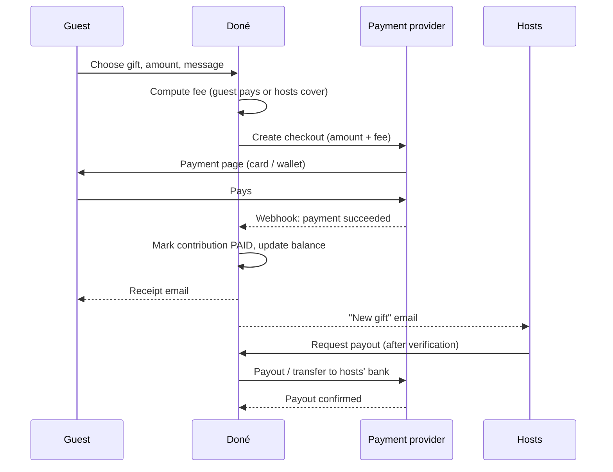

# SPEC — Doné

> Gift list ("cagnotte") and celebration website platform, built for Mauritius and its diaspora.
> Living spec. Status: **fast-track grilling complete — prototype spec ready for review.**
> Phase 3 (payments & compliance) is **deferred, not skipped**: it must be completed before any real money moves.
> Repo: `wmtm/don-`.

Legend: ✅ decided · 🟡 decided by Claude on the founder's delegation ("go with your recommendations") — open to change · ⛔ open / blocks launch

---

## 1. Vision & business model

### Audience ✅
- **Primary:** Mauritian **diaspora** hosts (France, UK, Australia, South Africa, Canada…), celebrating in Mauritius or abroad, guests spread across countries.
- **Secondary (from day one):** hosts living and celebrating in Mauritius, mostly local guests.
- **Out of scope for now:** foreign destination-wedding couples with no Mauritian ties.

### Occasions: not only weddings ✅ (scope widened by founder) / 🟡 details
- The product is a **gift list + celebration website for any personal occasion**. Weddings are the **flagship** (homepage, marketing, richest features) but the data model is generic from day one.
- 🟡 Supported occasion types: **wedding, engagement, birthday, birth / baby shower, religious ceremony (baptism, communion, naming…), housewarming, graduation, retirement / farewell, other**.
- 🟡 **Excluded:** charity, medical, funeral or "help me" fundraising. These are crowdfunding/charity collections with different legal, fraud and emotional risks; a lawyer must look at them separately.
- In the UI and data model the people receiving gifts are **hosts** (a couple for a wedding, parents for a birth…), not "the couple".

### Nature ✅
Startup product, intended to scale. Sole founder, Mauritian, resident in Mauritius. No launch date; the immediate goal is a **working prototype with test payments**.

### Revenue model ✅ hybrid
- By default the **guest pays a transparent service fee** shown at checkout; the hosts receive 100% of the gift.
- Hosts can toggle **"we cover the fees"**: the guest pays only the gift amount and the fee is deducted from the hosts' balance.
- **Prototype fee: 4%** (one config value). Real rate and margin set after Phase 3 (local card processing ~2.5–4%, unverified).
- Later add-ons (not MVP): premium templates, custom domain, vendor listings, partner commissions.

### Brand ✅
- **Doné** (Kreol: "to give") shown with the accent on screen; **`done`** in URLs and handles.
- **Tone:** warm & family-centred (sand, coral, lagoon green; rounded shapes; reassuring copy older relatives trust) with clean modern layouts and whitespace so it feels premium to diaspora hosts.
- The generic name fits the wider "any occasion" scope well.
- ⛔ Before launch: check domain + trademark availability; English readers see "done"; standard Kreol spelling is closer to "donn".

### Legal entity ⛔
- **None yet.** No business bank account yet.
- Working recommendation: **new Mauritian domestic company** (needed for local methods like Juice / local card acquiring).
- **Launch gate:** no real payments and no public launch until the entity exists, has a business bank account, and is onboarded by a payment provider. Registration + bank KYC + provider onboarding can take weeks each — likely the critical path, not the code.

### Differentiation
A diaspora couple in France can already use French services. Our edge: **multi-event celebrations**, the **digital envelope** ("lenvlop"), cultural event presets, paying easily **from Mauritius and from abroad**, MUR/EUR/GBP lists, and (later) Kreol.

---

## 2. Mauritian context

### Languages ✅
- **Launch: English + French.** Kreol Morisien later (trade-off accepted).
- All UI text in translation files from day one → Kreol is a translation job, not a code change.
- **Each occasion chooses its default language**; guests can switch anytime.
- Platform pages use the browser language (EN/FR), falling back to English.

### Multiple events per occasion 🟡
- An occasion has **one or more events**, each with: name, date & time, venue name, address, map link, dress code, notes, and its own RSVP.
- **Tradition presets** at creation (wedding only): the host ticks one or more traditions and we **pre-fill typical events** they can rename, reorder or delete. Nobody is forced into a box; mixed-tradition couples tick several.
  - Hindu: Haldi, Geet Gawai, Mehndi, Wedding ceremony, Reception
  - Tamil: Nalangu, Wedding ceremony, Reception
  - Telugu: Haldi, Wedding ceremony, Reception
  - Marathi: Haldi, Wedding ceremony, Reception
  - Muslim: Mehndi, Nikah, Walima
  - Chinese: Tea ceremony, Banquet
  - Christian: Church ceremony, Reception
  - Civil: Civil ceremony
  - ⛔ **Founder to review these lists for accuracy and naming before launch** (Claude's draft, not authoritative).
- Other occasion types start with a single event ("Party", "Ceremony"…) and can add more.
- **Per-guest invitations** (e.g. only close family sees the haldi) → **later**. MVP: every event on the site is visible to anyone with the link; hosts simply don't list an event they want to keep private.

### Gift habits 🟡
- **Digital envelope ("lenvlop") is a first-class gift**: every list automatically has an "Envelope" — the guest chooses any amount and writes a message, shown as an envelope. This digitises the dominant Mauritian habit instead of replacing it.
- Funds for things and experiences ("our sofa", "honeymoon in Rodrigues") with optional targets and progress bars; group contributions are natural (many guests → one fund).
- **Offline gifts:** hosts can record cash/cheque/physical gifts received in person so the thank-you list is complete. These never touch our payment flow.
- **Amount privacy:** guests may choose **"don't show the amount to the hosts"** — a real sensitivity in Mauritian families. Hosts see the guest's name and message; the amount still counts in their balance and totals.

### Currency 🟡
- Each occasion has **one list currency** chosen by the hosts: **MUR (default), EUR or GBP**.
- Prototype: guests pay in the list currency. Showing an approximate amount in the guest's own currency, and true cross-currency payment, come with Phase 3.
- Money stored as integer **minor units** (cents) + ISO currency code; no floats.

---

## 3. Payments & compliance ⛔ (deferred — must be completed before launch)

### Prototype behaviour
- All payments go through a **fake test provider** behind a `PaymentProvider` interface: guest "pays" on a simulated payment page (succeed / fail buttons), and everything downstream (balance, receipts, payouts) behaves as it will in production.
- Payouts are **simulated**: hosts request one; an admin marks it paid.
- Prototype banner on every page: "Test mode — no real money".

### Payment flow (target shape, provider TBD)



### Candidate payment options to research (unverified — Phase 3)
Local: MCB (Juice, MCB payment gateway), SBM, MIPS, Peach Payments, Emtel Blink, my.t money, bank transfer. International: card acquirers that onboard Mauritian companies, PayPal; check whether Stripe and similar platforms support Mauritian entities. Payouts abroad: Wise / Airwallex-type services. For each: fees, currencies, onboarding requirements, split/marketplace payouts.

### Questions for a Mauritian lawyer ⛔
1. If Doné **collects guest money and holds it** until hosts withdraw, is that a regulated payment service or e-money under the **National Payment Systems Act 2018** (Bank of Mauritius)? Can we avoid holding funds by using a licensed provider's marketplace/split-payout product?
2. Does any **FSC** regime (e.g. crowdfunding) apply to multi-contributor gift funds?
3. **AML/CFT (FIAMLA):** what KYC must we do on hosts before payout? Thresholds? Record-keeping?
4. **Cross-border:** collecting EUR/GBP from abroad, paying out to Mauritian or foreign bank accounts — bank reporting duties?
5. **Tax:** VAT on our service fee and registration threshold; any tax implications for hosts receiving gifts.
6. **Data Protection Act 2017:** registration with the Data Protection Office as controller; hosting data outside Mauritius (EU region); privacy notice; cookie consent; retention periods; photos of guests and children.
7. **Terms & conditions:** refunds, chargebacks, liability if an occasion is cancelled, fake-host fraud.
8. **Trademark** clearance for "Doné".

### Fraud & trust (design now, enforce at launch)
- Each occasion has a `verificationStatus`. **Payouts require verified hosts** (ID + bank account match, Phase 3).
- Admin can **hide** an occasion instantly.
- Refunds and chargebacks: admin can mark a contribution refunded; real handling in Phase 3.

### Data protection (prototype defaults)
- Collect the minimum: guest name, email (for receipt), message. Phone optional.
- No tracking cookies in the prototype → no consent banner needed yet; only a session cookie for logged-in hosts.
- Guest photos: only hosts upload; no guest uploads in MVP.

---

## 4. Gift list mechanics 🟡

| Gift kind | How it works |
|---|---|
| **Envelope** | Auto-created on every list. Free amount + message. Shown as an envelope card. |
| **Fund** | Title, description, image, optional target. Any amount; progress bar if target set. Covers "sofa", "honeymoon in Rodrigues/Seychelles/Réunion", experiences. |
| **Item** | Fixed price × quantity (e.g. 6 plates at MUR 500). Guest gives one or more whole units; marked "complete" when all units are given. |

- **Suggestions catalogue:** a small built-in list of ideas (honeymoon destinations, home, experiences) to add in one click. No partner stores in MVP.
- Guests can: leave a message; choose "don't show my amount to the hosts"; give without an account.
- Hosts see per guest: name, message, amount (unless hidden), date, gift. **Thank-you tracking:** a "thanked" checkbox per gift, and a CSV export.
- Hosts can record **offline gifts**.
- **Minimum gift:** MUR 100 / €5 / £5 (keeps fixed fees sensible).
- Partner stores, physical fulfilment, charity donations → later / excluded.

---

## 5. Celebration website & tools 🟡

### Public site sections (MVP)
Home (names, date, cover photo, short welcome), **Our story / About**, **Events** (schedule with venues, map links, dress code), **Gift list**, **RSVP**, **FAQ** (covers accommodation/transport too), **Photos** (up to 12 images).

### Customisation (MVP)
- **3 colour themes** in the Doné style + cover photo. No drag-and-drop builder.
- URL: `done.mu/<slug>` (e.g. `/priya-kevin`); slug chosen at creation, editable, unique.
- Custom domains, premium templates → later (revenue add-on).

### Planning tools
- **MVP:** RSVP per event + guest list built from RSVPs (CSV export).
- **Later:** checklist, budget, seating plan, imported guest list with per-guest invitations.

### Co-hosts
- An occasion can have **several host accounts** (both partners, or parents) with equal rights.

---

## 6. Guest experience 🟡
- **Find an occasion:** search by host names, filter by date/month. Occasions can be **public** (searchable) or **unlisted** (link only). Optional **password** on the whole site.
- **Mobile-first, low-bandwidth:** server-rendered pages, minimal JavaScript, compressed images, no heavy fonts or trackers. Target: gift page usable on a slow 3G phone.
- **Checkout in 3 steps** for older relatives: (1) pick gift & amount (preset buttons + free amount), (2) name / email / message, (3) pay. Large buttons, clear total including fee, no account needed.
- **Sharing:** "Share on WhatsApp" button with a pre-written message and link, plus copy-link. (WhatsApp is how Mauritian families will share it.)

---

## 7. Admin & operations 🟡
- **Admin dashboard (MVP):** list/search occasions, view contributions, mark payouts paid, mark refunds, hide/unhide occasion, set verification status.
- **Notifications (MVP):** email only — receipt to guest, "new gift" and "new RSVP" to hosts, payout updates. In the prototype emails are written to a dev mailbox/log, not sent.
- **Later:** SMS, WhatsApp Business notifications, support inbox/chat. MVP support = a contact email address.
- **Analytics from day one (internal, no third-party trackers):** occasions created/published, gifts given (count, volume, average, by currency), RSVPs, checkout conversion (started vs paid).

---

## 8. Tech & delivery

### Stack (proposed — awaiting founder OK)
| Layer | Choice | Why |
|---|---|---|
| App | **Next.js (App Router) + TypeScript** | One codebase for pages + API; server rendering = fast on slow phones; huge hiring pool |
| Styling | **Tailwind CSS** | Fast to build the design system; small CSS output |
| i18n | **next-intl** | Locale routing + translation files (EN/FR now, Kreol later) |
| Database | **PostgreSQL + Prisma** | Relational data with money; Prisma gives typed queries and migrations |
| Validation | **Zod** | One schema for forms and server checks |
| Auth | Email + password, sessions stored in DB (small in-house module) | Few dependencies, easy to audit; magic links later |
| Payments | `PaymentProvider` interface + **Fake provider** | Swap in the real provider after Phase 3 without touching business logic |
| Email | `Mailer` interface + dev log mailer | Real provider (e.g. Postmark/Resend) later |
| Tests | **Vitest** (logic) + **Playwright** (key flows) | Fee/balance maths unit-tested; create→give→payout flow tested end to end |
| Hosting | **Render**, EU (Frankfurt) region: web service + managed Postgres | Cheap, simple, low ops. ⛔ data-outside-Mauritius question for the lawyer |
| Images | Local disk in dev; S3-compatible storage (e.g. Cloudflare R2) in production | Cheap egress |

### Data model (prototype)
```
User(id, email, passwordHash, name, locale, isAdmin, createdAt)
Session(id, userId, expiresAt)
Occasion(id, slug, type, title, hostNames, date, welcome, story, coverImage, theme,
         defaultLocale, currency, hostsCoverFees, visibility[public|unlisted], passwordHash?,
         status[draft|published|closed], verificationStatus[unverified|pending|verified],
         hidden, createdAt)
OccasionHost(occasionId, userId)                       -- co-hosts
Event(id, occasionId, name, startsAt, endsAt?, venueName, address, mapUrl, dressCode, notes,
      rsvpEnabled, position)
Rsvp(id, eventId, guestName, email?, phone?, attending[yes|no|maybe], partySize, message?, createdAt)
Gift(id, occasionId, kind[envelope|fund|item], title, description, image?, targetAmount?,
     unitPrice?, quantity?, position, archived)
Contribution(id, occasionId, giftId?, guestName, guestEmail, message?, hideAmount,
             amount, fee, feePaidBy[guest|hosts], charged, currency, units?,
             source[online|offline], status[pending|paid|failed|refunded],
             provider, providerRef?, thanked, createdAt, paidAt?)
Payout(id, occasionId, amount, currency, status[requested|paid|rejected], bankDetailsMasked,
       requestedAt, paidAt?)
Photo(id, occasionId, url, caption?, position)
FaqItem(id, occasionId, question, answer, position)
```
Balance = Σ paid online contributions (amount − fee when hosts cover fees) − Σ payouts not rejected. Offline gifts never count toward the balance.

### Proposed file structure
```
src/
  app/[locale]/
    (marketing)/page.tsx            home
    find/page.tsx                   find an occasion
    auth/{login,signup}/page.tsx
    dashboard/                      host area: occasions, edit site, events, gifts,
                                    contributions, RSVPs, payouts
    [slug]/                         public occasion site: home, events, gifts,
                                    gifts/[giftId]/give, rsvp, faq, photos
    pay/[contributionId]/page.tsx   fake provider payment page (test mode only)
    admin/                          admin dashboard
  lib/
    money.ts      fees.ts           integer money + fee maths (unit-tested)
    payments/     provider.ts, fake.ts
    mail/         mailer.ts, dev.ts
    auth/         password, sessions
    presets.ts                      tradition → events presets
    db.ts                           Prisma client
  messages/ en.json fr.json         (kr.json later)
  components/                       UI kit in the Doné style
prisma/ schema.prisma, migrations/, seed.ts   (demo occasions for the prototype)
tests/  unit/, e2e/
```

### MVP milestones (each: runs locally, tests pass, demo shown to founder)
| # | Milestone | Done when |
|---|---|---|
| M0 | Skeleton | App boots, DB + migrations, EN/FR switch, Doné design tokens, lint/typecheck/test scripts |
| M1 | Host accounts & create occasion | Sign up, create an occasion "in 1 minute" (type, names, date, slug, traditions → events), dashboard |
| M2 | Public celebration site | Home, story, events, FAQ, photos, 3 themes, EN/FR, public/unlisted/password |
| M3 | Gift list | Envelope auto-created; funds & items CRUD; suggestions; public gift page with progress |
| M4 | Guest checkout (fake payments) | 3-step give flow, fee shown, hide-amount option, fake pay page, receipt email in dev mailbox |
| M5 | Host money view | Contributions list, thank-you tracking, offline gifts, balance, simulated payout request, CSV export |
| M6 | RSVP | RSVP per event, guest list + CSV |
| M7 | Find & share | Search by names/date, WhatsApp share, copy link |
| M8 | Admin | Occasions, contributions, payouts, refunds, hide, verification status, basic stats |

### Out of scope for the prototype
Real payments and payouts · Kreol · cross-currency conversion · partner stores / fulfilment · vendor directory · blog · checklist, budget, seating · per-guest invitations · custom domains, premium templates · SMS/WhatsApp notifications · native mobile apps · charity/medical/funeral fundraising · guest photo uploads.

---

## Open items (summary)
- ⛔ Legal entity, bank account, payment provider onboarding.
- ⛔ Phase 3 research: providers, fees, currencies, payouts; final fee rate.
- ⛔ Lawyer questions (section 3).
- ⛔ Domain/trademark for Doné.
- ⛔ Founder review of tradition event presets.
- ⛔ Founder OK on stack, data model, file structure and milestones → then build starts at M0.
